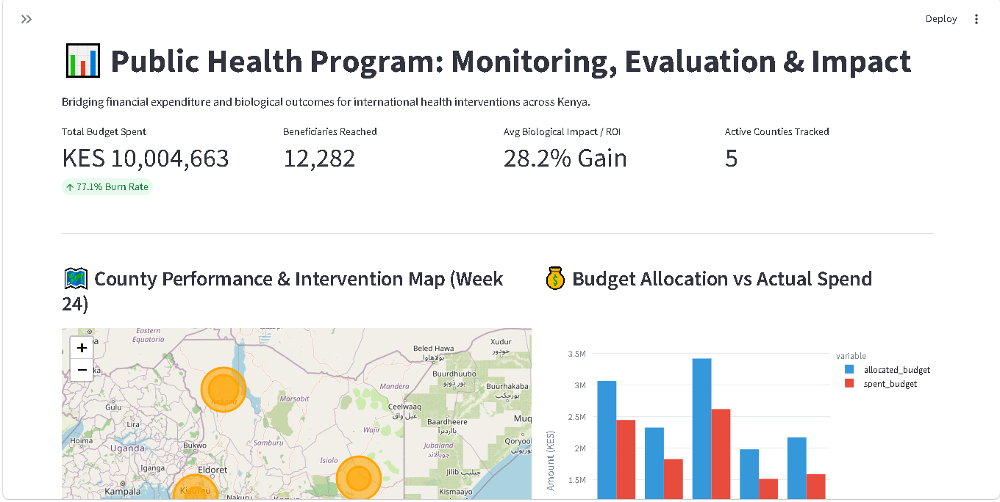
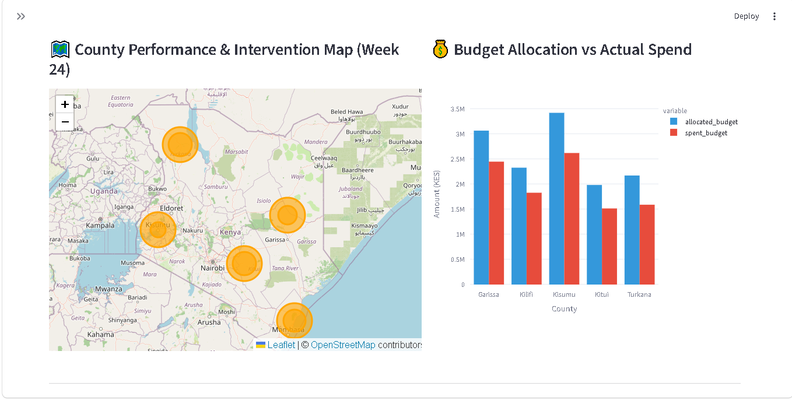
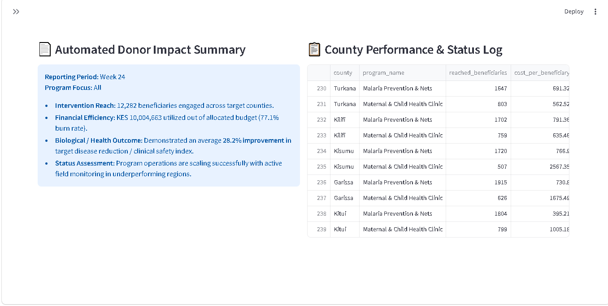

# 📊 Public Health Program: Monitoring, Evaluation & Impact Dashboard

A strategic intelligence platform designed for Program Managers and Monitoring & Evaluation (M&E) Officers to track financial expenditure alongside biological health outcomes, proving the return on investment (ROI) of global health interventions.

---

## 📊 Dashboard Preview
![Public Health M&E Dashboard Preview]




> **Live Interactive Demo:** [Launch Dashboard](https://ngo-me-dashboard-11.streamlit.app/)

---

## 🎯 The Problem & Business Impact

International health NGOs run complex, multi-million-dollar interventions (e.g., malaria net distribution, maternal health clinics), but proving impact to donors is often a manual, fragmented process. Traditional M&E workflows suffer from three critical bottlenecks:

1. **Siloed Data:** Financial expenditure logs and clinical health outcome reports are kept in separate systems, obscuring true cost-effectiveness.
2. **Delayed Reporting:** M&E teams spend weeks manually compiling static PDF donor reports, delaying decision-making.
3. **Sub-optimal Resource Allocation:** Program managers lack real-time visibility into underperforming regions, preventing timely budget and resource reallocation.

---

## 💡 The Solution

This platform bridges the gap between financial accountability and biological impact. By uniting localized SQLite database queries, financial utilization tracking, GIS mapping, and automated reporting, the dashboard empowers NGOs to transition from static reporting to predictive, impact-driven program management.

---

## 🚀 Key Features

### 1. Financial vs. Operational Efficiency
* **Budget Utilization Tracking:** Monitors grant expenditure versus total allocated funding in real time.
* **Operational Target Progress:** Measures field distribution metrics against planned milestones (e.g., mosquito nets distributed vs. target).
* **Unit Cost Metrics:** Calculates the exact *Cost per Intervention* (e.g., cost per distributed net or patient served).

### 2. Biological & Clinical Impact (Return on Investment)
* **Outcome Correlation:** Directly links intervention volume with local epidemiological trends (e.g., correlating net coverage rates with reduction in malaria incidence).
* **Clinical Health Targets:** Measures progress against primary health indicators, such as reductions in target disease transmission and maternal mortality.

### 3. County-Level Geospatial Performance Map
* **Interactive GIS Mapping:** Uses Folium to render county-level performance markers color-coded by target achievement status (Green = On Track, Red = Underperforming).
* **Spatial Resource Tracking:** Pinpoints geographical areas where funding gaps correlate with high disease burdens.

### 4. Automated Donor Executive Summary
* **Real-time Report Synthesis:** Dynamically calculates and formats key metrics (Funds Used %, Total Beneficiaries Reached, Health Outcome Reduction %) for immediate executive and donor export.

---

## 🛠️ Technical Architecture & Stack

* **Data Engineering & Simulation:** Python (`pandas`, `numpy`) generating a synthetic 6-month longitudinal dataset simulating a Malaria Prevention & Maternal Health initiative across 5 Kenyan counties.
* **Database Engine:** `SQLite` (`project_data.db`) storing relational tables for grant budgets, field logs, and clinical outcomes.
* **Geospatial & Analytics Interface:** `Streamlit`, `folium` (`streamlit-folium`), and `plotly` providing a responsive web UI.

```text
ngo-me-dashboard/
│
├── app.py                      # Core Streamlit dashboard application
├── generate_me_data.py         # Data generator & SQLite population pipeline
├── requirements.txt            # Python dependencies (streamlit, pandas, plotly, folium, streamlit-folium)
├── README.md                   # Technical documentation
│
├── data/
│   └── project_data.db         # SQLite relational database (Financials & Health Outcomes)
│
└── screenshots/
    ├── dashboard1.png     
    ├── dashboard2.png  
    └── dashboard3.png       
📸 Additional Dashboard Views
1. Financial & Target Analytics
2. Regional Performance & GIS Heatmap

⚙️ Installation & Local Setup
To run this dashboard locally on your machine:

Clone the repository:

```bash
git clone [https://github.com/PageG80/ngo-me-dashboard.git]
cd ngo-me-dashboard
```

Initialize the SQLite Database & Generate Data:

```bash
python generate_me_data.py
```

Launch the Streamlit Dashboard:

```bash
streamlit run app.py
```